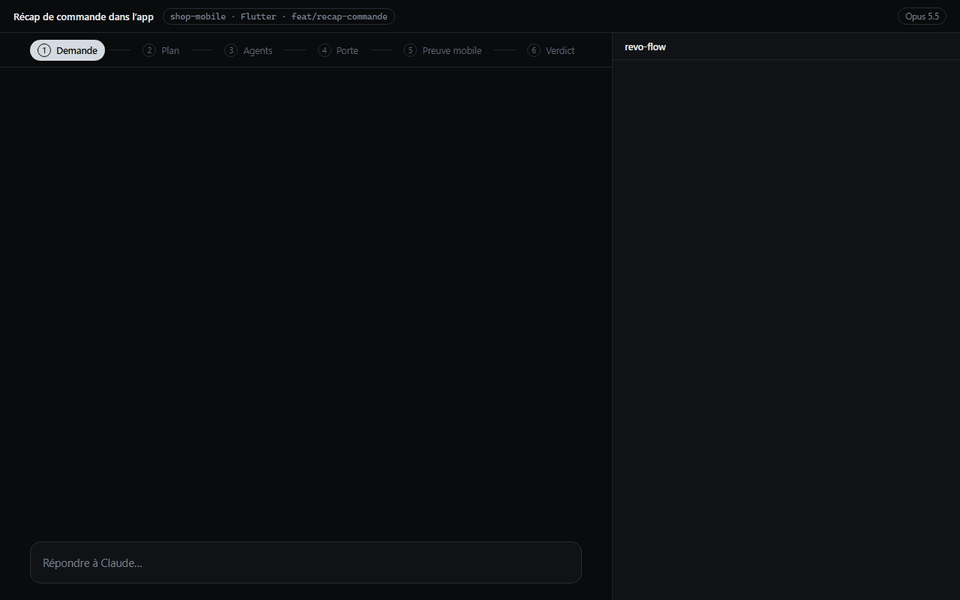

# revo-flow

[English version](README.md) (résumé) · cette page est la documentation complète, en français.

Mod Claude Code qui orchestre une demande avec une équipe de sous-agents, et montre l'avancement de chacun.



*Un flow complet de la v3.1 avec preuve mobile sur une app de démo, rejoué avec les dessins du panneau : plan, agents, porte, le vérificateur lance l'app sur le téléphone, lit le total, touche « Valider », verdict. La preuve web dans Chrome : [docs/demo-preuve-web.gif](docs/demo-preuve-web.gif).*

## Installation

Rien à télécharger : Claude Code récupère le dépôt tout seul depuis GitHub. Deux façons, au choix.

**Depuis une session Claude Code en terminal :**

```
/plugin install revo-flow --marketplace LilianMLG/revo-flow
```

Réponds `y` pour ajouter le marketplace, puis Entrée pour la portée **user**. Le mod est actif tout de suite.

**Depuis n'importe quel terminal (PowerShell, bash…), sans ouvrir Claude :**

```
claude plugin marketplace add LilianMLG/revo-flow
claude plugin install revo-flow@revo-flow
```

Dans les deux cas, le mod est ensuite chargé dans chaque nouvelle session, en terminal comme dans l'app desktop.

**Mise à jour automatique (recommandé) :** dans Claude Code, `/plugin` → **Marketplaces** → **revo-flow** → **Enable auto-update**. Au lancement de chaque session, Claude Code récupère alors la dernière version publiée du mod, sans commande à taper ; **Disable auto-update** au même endroit l'arrête. Les marketplaces tiers sont désactivés par défaut, d'où ce réglage à faire une fois.

Une nouvelle version n'est détectée que si `version` change dans `.claude-plugin/plugin.json` : chaque modification publiée sur `main` monte ce numéro. Si l'option n'apparaît pas, c'est que les mises à jour automatiques de Claude Code sont coupées sur ce poste (`DISABLE_AUTOUPDATER`) ; `FORCE_AUTOUPDATE_PLUGINS=1` les rétablit pour les plugins seuls.

**Mise à jour à la main :**

```
claude plugin marketplace update revo-flow
claude plugin update revo-flow@revo-flow
```

## Utilisation

```
/revo-flow <ta demande>
```

1. **Analyse** : le modèle de la session lit la demande et les specs. Le panneau affiche « En attente du plan d'exécution ». Pour une lecture large, il peut lancer un **éclaireur** Explore (lecture seule) : revo-flow demande d'abord **Autoriser** ou **Refuser** ; son coût compte pour l'orchestrateur. Tout autre agent est refusé avant le plan.
2. **Plan** : il décide combien de sous-agents il faut (1 à 6), le modèle (Haiku, Sonnet, Opus) et l'effort de chacun, et la liste des tâches de chacun.
3. **Validation** : le plan s'affiche (agents, modèles, efforts, nombre de tâches) et attend **Lancer** ou **Annuler**, dans le dialogue ou avec les boutons du panneau. Le dialogue montre le plan complet en markdown dans un aperçu à côté des deux choix : chaque agent, son rôle, la raison de son modèle et ses tâches numérotées. Le même plan est écrit dans `~/.claude/revo-flow/plans/<titre>.md`, que le bouton **plan.md** du panneau ouvre dans l'application par défaut. Aucun agent ne part avant. Annuler, ou fermer le dialogue (Échap), renvoie l'orchestrateur à la planification.
4. **Exécution** : les agents sont lancés. revo-flow ajoute au prompt de chacun sa liste de tâches (celles déjà faites cochées ✓ quand il est relancé), la façon de les signaler (un appel `step` au début de chaque tâche) et, avec le cache, l'extrait de la fiche servie qui le concerne. Chacun a sa barre de progression, de sa couleur, avec « n/total » et la tâche en cours. Un agent qui dépend du travail d'un autre signale une **attente** (« Attend « Y » » dans le panneau, ni fini ni en échec) et termine son tour ; quand Y a fini, revo-flow demande à l'orchestrateur de le reprendre avec `SendMessage` (il garde tout son contexte et revo-flow le suit de nouveau) ou de le relancer avec l'outil Agent, pour ses tâches restantes. Si Y a échoué, n'est pas du plan ou l'attend lui-même, l'orchestrateur est prévenu et décide. Un Agent lancé hors du plan n'est pas suivi. Un agent qui a rendu son rapport mais que Claude Code garde en `waiting` (un travail de fond à lui) compte comme fini, et reprend sa barre s'il se réveille.
5. **Fin** : l'orchestrateur vérifie le tout et fait la synthèse. Une notification donne la durée, le coût et le nombre de fichiers, et le flow entre au journal (`/revo-flow historique`).

Pendant le flow, les durées et « inactif depuis » avancent seuls, un agent sans aucune requête depuis 3 min est signalé une fois (toast et notification), et une ligne d'état sous le prompt résume `revo-flow · titre · 62 % · 3 actifs · 0,41 €`.

Sans `/revo-flow`, le mod ne fait rien : pas même un outil déclaré (`plan`, `step` et `cache` arrivent au premier flow ou `cache build`). Un nouveau `/revo-flow` pendant un flow pas fini demande **Remplacer** ou **Garder le flow en cours**.

| Commande | Effet |
| --- | --- |
| `/revo-flow <demande>` | lance un flow |
| `/revo-flow statut` | où en est chaque agent |
| `/revo-flow panneau` | affiche ou masque le panneau latéral |
| `/revo-flow historique [n]` | les n derniers flows (10 par défaut) : date, durée, coût, agents, échecs et relances, puis par modèle le coût moyen d'un agent, son taux d'échec et ses relances |
| `/revo-flow stop` | arrête vraiment : les agents en cours (TaskStop) et le tour de l'orchestrateur, après confirmation (Échap : rien ne change), puis retire la barre et le panneau |
| `/revo-flow doctor` | ce que le mod a trouvé sur le projet courant : stack, commandes de vérification, base de référence, cache, agents installés, preuve à l'exécution (ligne `Web` : commande et port détectés, d'où ils viennent, outils, état de `REVO_WEB_LOGIN` ; ou « aucun serveur de dev détecté (pas de script dev) : pas de preuve web » ; ou « preuve web désactivée (option web) » ; sur une app mobile, ligne `Mobile` à la place : framework, plateformes, appareils vus (téléphone branché, émulateur, simulateur) ; c'est la seule commande qui liste les appareils), pièges ; lecture seule, rien n'est lancé ni modifié |
| `/revo-flow version` | la version du mod |
| `/revo-flow cache` | le graphe du projet courant : panneau (section « Cache » dépliée) et texte dans le terminal |
| `/revo-flow cache <projet>` | le graphe de n'importe quel projet de `Documents/Front` ou `Documents/Back` (`reservation-tool`, `back/graphql`) |
| `/revo-flow cache build [feature \| --top N \| --tout]` | sans argument : reconstruit la couche mécanique et liste les features candidates avec leur coût ; avec : lance un sous-agent en arrière-plan qui écrit la fiche, après confirmation du coût (`--tout` déconseillé) |
| `/revo-flow cache clear [feature]` | supprime le graphe du projet, ou une seule fiche, après confirmation |
| `/revo-flow cache <mot-clé>` | cherche dans le graphe (3 mots au plus) ; alias sans ambiguïté : `/revo-flow graphe …` |

**Boutons du panneau** : **Lancer** / **Annuler** / **plan.md** (validation du plan), **Arrêter** sur chaque agent en cours et **Tout arrêter**, après confirmation avec le coût déjà dépensé (un flow arrêté finit « arrêté », sans relance ni fiche apprise), et **Relancer** sur un agent en échec ou en attente (« Attend « Y » ») : il repart de ses tâches non terminées et l'orchestrateur le relance. Un agent en attente est aussi relancé tout seul dès que l'agent qu'il attend a fini. Le panneau s'adapte aussi au mobile.

**Tokens et contexte** : en terminal, la ligne de fin de tour (« Baked for… ») devient `⏱ durée · tokens in · out · cache API · coût · modèle` (et `cache n hits ≈ -18k` quand le cache projet a servi). La barre au-dessus du prompt ajoute une 2e ligne avec le dernier prompt et `ctx n %`, et le panneau a une jauge de contexte. Après une compaction, le rôle d'orchestrateur et l'état des agents sont réinjectés.

## Reprise après redémarrage

Pendant un flow, revo-flow garde un instantané de son état (plan, tâches faites, agents) dans le store du plugin. Si Claude Code est fermé ou redémarre en plein flow, la session suivante propose :

- **Reprendre** : les agents sont relancés sur leurs tâches restantes (celles déjà faites restent cochées) ;
- **Abandonner** : le flow est journalisé comme arrêté (`/revo-flow historique`).

Le contexte des agents n'est pas restauré : un agent repris repart de sa liste de tâches et de l'extrait de fiche du cache, pas de sa conversation d'avant.

L'instantané (`flow:<id>` dans le store du plugin) est réécrit à chaque changement du flow et effacé quand le flow finit, est arrêté ou remplacé. Seul l'instantané du même projet est proposé ; sans personne à qui demander (`claude -p`), le flow est abandonné sans question ; dialogue fermé, il attend le prochain démarrage.

## Rapport de flow

En fin de flow, revo-flow écrit un rapport markdown dans `~/.claude/revo-flow/rapports/<titre>.md`, à côté du plan. Le bouton **rapport.md** du panneau l'ouvre dans l'application par défaut. Six sections :

1. la demande et le plan (agents, modèles, efforts, tâches faites) ;
2. les fichiers modifiés, par agent ;
3. le verdict de la porte : commandes lancées, durée, erreurs nouvelles, exceptions accordées ;
4. les critères et le verdict du vérificateur, avec la preuve de chacun ; une preuve web y est liée (« Preuve web : serveur « npm run dev » sur http://localhost:3000, 2 captures : … », chemins des `capture-n.png`) ;
5. le score CRAP des fonctions modifiées ;
6. durée, coût, tokens évités par le cache.

Il peut servir de description de MR.

## Cache projet

revo-flow garde pour chaque projet un **graphe de connaissances** dans `~/.claude/revo-flow/graphs/<front-projet>.json`, hors des dépôts.

- **Couche mécanique**, sans LLM : fichiers, imports (alias, auto-imports Nuxt 3, Vuex par chaîne, balises de composants ; en Dart, `package:<projet>/` et relatifs, avec la stack lue dans `pubspec.yaml` ; stack aussi lue dans `package.json`, `.claude-plugin/plugin.json`, `tsconfig.json`, `pyproject.toml`, `requirements.txt`, `go.mod`, `Cargo.toml`), un **résumé d'une ligne par fichier** (1re phrase du commentaire de tête ou titre d'un .md, sans LLM), routes, stores, opérations GraphQL et endpoints (jamais tirés des fichiers de test), tests et docs. Reconstruite en 1 à 2 s, vérifiée par hash git à chaque usage ; un graphe d'un format plus ancien est reconstruit tout seul, fiches gardées.
- **Fiches de feature**, écrites par un modèle : résumé, flux, points d'entrée, fichiers et rôles, pièges, confiance. Apprises par l'orchestrateur **à la fin de chaque flow** (≈ 0,02 €), ou construites à la demande par `cache build` (≈ 0,20 €). Une fiche périmée n'est jamais supprimée : elle signale les fichiers modifiés depuis, et masque son flux au-delà de 50 % de changements. Une nouvelle fiche sans aucun fichier connu est refusée ; les fichiers ajoutés en fin de flow sans relecture comptent « à vérifier ».
- **Fiche auto de fin de flow** (quand personne n'a appelé `apprendre`) : ses fichiers rejoignent la fiche existante qui en partage le plus (au moins 2 et 30 %), sinon ils forment un **brouillon** : hors brief, hors correspondance et hors rappel après compaction, supprimé après 10 flows sans usage, promu en vraie fiche par un `apprendre`. La notification de fin dit « fiche auto « x » (rattachée) » ou « brouillon « x » ».

**Au lancement de `/revo-flow <demande>`** : si une fiche correspond à la demande, un dialogue propose **Utiliser** ou **Ignorer** (sous `claude -p`, elle est utilisée ; dialogue fermé : ignorée). Quand la recherche hésite (zone grise : aucune fiche ne ressort nettement, mais certaines touchent la demande), **Haiku tranche** entre les 25 meilleures fiches (id, titre, alias ; ≈ 1k tokens, 5 s au plus) : sa réponse passe par la même question, marquée « proposée par Haiku » ; « aucune », un échec ou un délai dépassé : pas de fiche. La confiance affichée **décroît** quand le code autour a bougé : −10 % par tranche de 20 commits sur les fichiers voisins de la fiche (hors fiche) depuis son apprentissage, −5 % par mois au-delà d'un mois, jamais sous 0,3 par ce seul effet. Un brief d'au plus 1 200 tokens est alors injecté à l'orchestrateur. Le brief est une carte, pas la vérité : l'orchestrateur vérifie dans le code ce qu'il modifie. Sans fiche, le brief garde la liste des features connues et ajoute une **carte à froid** (≈ 700 tokens au plus) : les fichiers probables pour la demande, classés par pertinence (nom, exports, résumé, mots-clés des commentaires, avec quelques mots français traduits vers ceux du code) puis par centralité (PageRank sur les imports, personnalisé par la demande), chacun avec son résumé d'une ligne. Rien ne ressort : les fichiers les plus centraux.

**Côté agents** : quand une fiche est servie, revo-flow ajoute au prompt de chaque sous-agent un **extrait** d'au plus 600 tokens : les fichiers de la fiche que sa mission cite (sinon les fichiers d'entrée, cœur et données), marqués ⚠ s'ils ont changé depuis l'apprentissage, leurs pièges et le résumé. Ces fichiers sont comptés comme servis à cet agent (sa couleur dans le panneau). L'orchestrateur n'ajoute que ce qui manque (pièges transverses, décisions). Chaque agent a aussi l'outil ci-dessous, avec la consigne de chercher dans le cache avant d'explorer quand le projet a des fiches (sinon seulement `voisins`).

**Fiche périmée** : elle n'est pas seulement signalée, elle se vérifie. L'agent voit ce qui a changé (`diff`), relit ce qu'il faut, puis `rafraichir` si la fiche reste juste pour ces fichiers (leurs hash sont remis à jour, la fiche redevient fraîche quand plus rien n'est périmé), ou `apprendre` avec `corrections` si elle est fausse.

**Outil `mcp__revo-flow__cache`**, pour l'orchestrateur et les agents :

| Action | Effet |
| --- | --- |
| `chercher` | mots-clés → features et fichiers pertinents, une ligne chacun |
| `feature` | la fiche d'une feature, avec sa fraîcheur |
| `voisins` | ce qu'un fichier utilise et qui l'utilise : à essayer avant un grep « qui utilise X » |
| `diff` | ce qui a changé depuis l'apprentissage : `feature` → ses fichiers modifiés (5 au plus), `chemin` → ce fichier seul (≤ 2 500 tokens) |
| `rafraichir` | `feature` et `fichiers` relus, toujours conformes : leurs hash sont remis à jour, sans toucher au résumé, au flux ni aux pièges |
| `apprendre` | enregistre ou complète une fiche (chemins inconnus rejetés ; un champ absent garde sa valeur) |
| `oublier` | supprime une fiche |
| `candidates` | les features repérées dans les commits, sans fiche, avec leur coût de construction |

**Panneau et bande** : section « Cache » pliable avec les nœuds servis (● couleur de l'agent), frais (○) et périmés (⚠), la mesure, les tokens évités et le coût de construction ; la bande ajoute `cache : 12 nœuds · 3 utilisés · ≈ 18k tokens évités`. Les tokens évités sont une estimation prudente (« ≈ ») : un fichier de fiche servi frais et non relu ne compte que s'il est cœur, entrée ou données, ou s'il a été lu dans un flow antérieur de la même fiche ; un fichier seulement listé par `chercher` ou `voisins` compte pour un quart de sa taille (un dixième au second saut) ; le tout moins ce que le cache a injecté.

**Mesure** : chaque flow terminé (pas un flow arrêté) entre au **journal** du graphe (200 derniers), cache activé ou non : tokens lus par Read (≈ 9 tokens par ligne d'une lecture partielle) et par une lecture Bash d'un seul fichier (`cat`, `sed -n`, `head`, `tail` ; les autres commandes Bash ne comptent pas), sorties de Grep et Glob, tokens injectés et évités. La section « Cache » en tire une ligne `Lus par flow : sans cache 12k (4) · sans fiche 9k (6) · avec fiche 5k (3)`, et la feature qui gagne le plus entre ses flows d'avant sa fiche et ceux où elle a été servie (même feature : bien moins de variance). Pour remplir la colonne « sans cache », désactive l'option `cache` sur quelques flows ; le graphe doit déjà exister (il n'est pas construit pour mesurer). Un fichier modifié par un agent fait revérifier le graphe au prochain appel, sans attendre 30 s.

## Flow vérifié

Depuis la v2, un flow ne finit plus « terminé » sur un lint, un typage ou un test rouge sans que quelqu'un l'ait décidé en le sachant. revo-flow **exécute lui-même** les vérifications du projet (zéro token : ce sont des commandes, pas un modèle) ; ce qu'un agent écrit (« j'ai lancé les tests, tout passe ») ne compte pas. Il ne corrige rien et ne relance personne : il rapporte, l'orchestrateur décide.

- **Commandes du projet** : au premier flow d'un projet, revo-flow les déduit (scripts de `package.json`, `pubspec.yaml`, CI, `biome.json`, `tsconfig.json`…) : ESLint, Biome, `tsc`, `nuxi typecheck`, `vue-tsc`, `vitest related`, `jest --findRelatedTests`, `dart analyze`, `flutter test` sur les tests liés, `codegen` ou `build_runner` quand un fichier source de génération change. Un dialogue montre les commandes exactes, leur portée et leur source : **Utiliser**, **Ajuster** ou **Pas de vérification**. Elles sont rangées dans le graphe (`projet.verif`) et redemandées si un manifeste change. Sans personne pour répondre (`claude -p`), **Utiliser** bascule en mode observateur : la vérification tourne, sans bloquer. Échap : pas de vérification pour ce flow. Sous Windows, `npx`, `npm` et `flutter` passent par `cmd /c`.
- **Portée ciblée** : les fichiers modifiés du flow, les tests liés (par la commande, ou par les arêtes `teste` du graphe en Dart), le typage du projet une seule fois par porte, le tout découpé par paquet dans un monorepo. Un test rouge est relancé seul : vert à la relance, il est noté **instable** et ne bloque plus. Les tests qui demandent un service (sandbox, base locale) sont exclus. Le `build` (`nuxt build`, `nest build`) reste hors porte. Une commande dure 10 min au plus (pas de `spawn`) : une suite plus longue n'a rien à faire dans la porte.
- **Base de référence** : pendant la planification, en arrière-plan, revo-flow lance lint et typage sur le projet (rien n'est modifié) et garde les signatures des erreurs (sans numéro de ligne), par commit, pour les 3 derniers. À la porte, seules les erreurs **nouvelles** comptent ; les préexistantes sont montrées à part. Une commande sans base (tests liés) donne « nouvelle ? », que l'utilisateur tranche.
- **Porte de fin** : quand tous les agents ont fini, la porte démarre aussitôt, pendant que l'orchestrateur relit. À la conclusion de l'orchestrateur, vert : le flow se termine « vérifié ✓ ». Rouge : sa fin est refusée et il reçoit les erreurs nouvelles (30 au plus, groupées par fichier, 4 000 tokens au plus, avec le chemin de la sortie complète), puis corrige lui-même, reprend un agent par `SendMessage` ou en relance un. **3 tentatives** au plus, puis un dialogue : **Terminer non vérifié**, **Une tentative de plus** ou **Voir le détail**. Si revo-flow plante, la porte s'ouvre et le flow est marqué « non vérifié (erreur de revo-flow) ».

**Outil `mcp__revo-flow__verif`**, pour l'orchestrateur et les agents :

| Action | Effet |
| --- | --- |
| `lancer` | orchestrateur : lance la vérification sur tout le flow (ou les fichiers donnés). Les sous-agents ne vérifient pas : la porte le fait une seule fois, quand tous ont fini, et un agent renvoyé corriger reçoit une tâche « Corriger la porte (…) » dans sa barre |
| `resultat` | tous : le dernier résultat (commandes, erreurs nouvelles, préexistantes, instables) |
| `commandes` | orchestrateur seul : une liste de commandes corrigée, ou des tests à exclure ; toujours reposée à l'utilisateur |
| `exception` | orchestrateur seul : terminer malgré le rouge, avec un motif ; toujours reposée à l'utilisateur |
| `degeler` | orchestrateur seul : rouvrir un test gelé, avec un motif ; toujours reposée à l'utilisateur |
| `web` | vérificateur et orchestrateur : démarre (ou reprend) le serveur de dev du projet pour la preuve web et rend l'URL ; toujours demandée à l'utilisateur ; voir « Preuve web ». Sur une app mobile, renvoie vers `mobile` |
| `mobile` | vérificateur et orchestrateur : choisit l'appareil, lance (ou reprend) l'app du projet pour la preuve mobile et dit quand elle est à l'écran ; toujours demandée à l'utilisateur ; voir « Preuve mobile » |

**Critères d'acceptation, vérificateur, tests gelés** (sur décision de l'orchestrateur, jamais automatiques ; ≈ 0,5 à 1,3 € de plus par flow) :

- **Critères** : le plan peut porter 1 à 8 critères vérifiables (C1 à C8), montrés à la validation du plan et dans `plan.md`.
- **Testeur** : un agent de tâches `test` traduit les critères en tests, à partir de la spec et des interfaces, pas du code écrit ; il ne touche qu'aux fichiers de test. Ses tests **restent dans le dépôt**.
- **Tests gelés** : à la fin du testeur, ses fichiers sont gelés par hash git. Un `Edit` ou `Write` d'un autre agent ou de l'orchestrateur dessus est refusé (le refus se ferme : un plantage refuse aussi), et une modification par Bash est détectée à chaque porte. Seul `degeler`, confirmé par l'utilisateur, les rouvre.
- **Vérificateur** `revo-flow:verifier` : en lecture seule (aucun `Edit`, `Write` ni `NotebookEdit`, Bash limité aux lectures git, `cat`, `ls`, `grep` et aux commandes confirmées), contexte neuf, prompt calibré. Pour chaque critère il rend `ok`, `ko` ou `non vérifiable`, avec la preuve exécutée ; un critère sans verdict compte « non vérifiable ».
- **Triche** : le diff du flow est cherché pour `.skip`, `.only`, `xit`, `test.todo`, moins d'`expect` dans un test modifié, `eslint-disable`, `@ts-ignore`, `@ts-expect-error`, `biome-ignore`, `as any`, ou une configuration de lint, de test ou de typage modifiée. Un test gelé ou un garde-fou modifié garde la porte rouge jusqu'à la réponse de l'utilisateur ; les autres motifs sont signalés sans bloquer.

**Option `verif`** (`/config`) : `bloquer` (défaut) tient la porte ; `observer` lance et affiche la vérification sans jamais bloquer ; `off` ne fait rien.

**Affichage** : section « Vérification » du panneau (une ligne par commande : état, fichiers, erreurs nouvelles, durée ; tentative n/3 ; tests gelés ; triches ; critères ; boutons **Détail**, qui ouvre la sortie complète, et **Relancer**), segment de bande `vérif ✓ 3/3`, `vérif ✗ typecheck (2)` ou `vérif …`, notification de fin « vérifié ✓ » ou « non vérifié (typecheck ✗) », colonne « vérif » de l'historique (`✓`, `✗ accepté`, `✗`, `✗ erreur`, `observé`, `—`). Les sorties complètes sont dans `~/.claude/revo-flow/verif/<date>-<flow>/` (les 20 derniers flows gardés).

**Mesure** : le journal du graphe note pour chaque flow l'état de la vérification, ses tentatives, ses erreurs nouvelles et sa durée. La section « Cache » du panneau en tire le taux d'échappement (flows observés rouges), la part de flows rouges au premier passage, les erreurs nouvelles attrapées, les flows acceptés non vérifiés et la durée moyenne de la porte.

### Preuve web

Depuis la v3.0, le vérificateur peut **voir l'application tourner**. C'est ce que ni le lint, ni le typage, ni les tests unitaires ne voient : page blanche, erreur d'hydratation, erreur console, appel réseau en 4xx ou 5xx, composant absent, texte de traduction manquant. Elle n'est lancée que pour un flow avec des critères, quand le vérificateur la demande (≈ 0,2 à 0,6 $ et 1 à 3 min de plus).

- **Déroulé** : le vérificateur appelle l'action `web` de l'outil `verif`. revo-flow détecte le serveur de dev : script `dev` de `package.json`, sinon un `start` qui lance `nuxt`, `next dev`, `vite`, `astro dev` ou `ng serve` ; gestionnaire d'après le lockfile (npm, pnpm, yarn, bun) ; port lu dans le script, `.env` (`PORT=`), `nuxt.config.*` (`devServer.port`), `vite.config.*` (`server.port`), sinon le défaut du framework (Nuxt et Next 3000, Vite 5173, Astro 4321, Angular 4200). Un dialogue demande « Démarrer « npm run dev » pour <projet> (port 3000) ? » : **Démarrer** ou **Pas cette fois**. Sans personne à qui demander (`claude -p`) ou sur Échap : pas cette fois. Sur **Démarrer**, le serveur part (`cmd /c` sous Windows), revo-flow lit sa sortie jusqu'à l'URL (« Local: http://localhost:3000 »), 90 s au plus ; port pris ou serveur mort, il le dit.
- **Port déjà pris** : revo-flow demande « Utiliser http://localhost:3000 pour la preuve web ? » et ne tue rien.
- **Navigation** : le vérificateur reçoit l'URL et navigue avec l'extension **Claude in Chrome** (`navigate`, `read_page`, `find`, `computer` pour la capture, `read_console_messages`, `read_network_requests`), **seulement sur cette origine** : une autre origine est refusée (le navigateur de l'utilisateur n'est pas à lui), et tout outil navigateur est refusé tant qu'aucun serveur n'est accordé.
- **Ce qu'est une preuve** : l'URL visitée, l'élément ou le texte vu, le nombre d'erreurs console et de réponses 4xx/5xx, et « capture n ». Une capture seule n'est pas une preuve. Le verdict du critère porte `"web": true`.
- **Captures** : chaque capture d'écran du vérificateur est rangée avec les sorties du flow, `~/.claude/revo-flow/verif/<date>-<flow>/capture-n.png.txt` (texte base64), décodée en `capture-n.png` quand `certutil` ou `base64` est là. Le panneau les montre (bouton **capture**) et le rapport de flow les lie.
- **Fin** : le serveur démarré par revo-flow est toujours arrêté en fin de flow (ou par **Tout arrêter**). Un serveur qui tournait déjà n'est jamais touché.
- **Connexion** : revo-flow ne stocke ni ne lit aucun compte de test. Si l'application demande une connexion, définis la variable d'environnement `REVO_WEB_LOGIN` pour ton serveur de dev (c'est lui qui la lit) ; revo-flow signale seulement si elle est définie ou absente (`/revo-flow doctor`, consigne du vérificateur). Le vérificateur n'entre jamais d'identifiant : une page de connexion sans la variable donne « non vérifiable ».
- **Option `web`** (`/config`) : `extension` (défaut) : comme ci-dessus ; `devtools` : en plus, le serveur MCP **Chrome DevTools** (`npx chrome-devtools-mcp@latest --isolated`) est déclaré pour le vérificateur, en repli quand l'extension n'est pas là (`navigate_page`, `take_snapshot`, `take_screenshot`, `list_console_messages`, `list_network_requests`) ; `off` : aucune preuve web, l'action `web` répond que c'est désactivé.
- **Mesure** : le journal du graphe note la preuve web de chaque flow (état, captures, verdicts web, ko web), pour compter d'abord « combien de flows où la preuve web trouve ce que la porte n'a pas vu ».
- **Limites** : l'extension Claude in Chrome est requise (ou l'option `devtools`) ; seuls les serveurs Nuxt, Next, Vite, Astro et Angular sont reconnus ; une application sans script `dev` n'a pas de preuve web ; un seul navigateur, une seule taille ; un `build` n'est pas servi. Une app mobile passe par la preuve mobile ci-dessous.

### Preuve mobile

Depuis la v3.1, le même vérificateur peut **voir une app mobile tourner**, sur un téléphone branché ou dans un émulateur. revo-flow choisit tout seul la preuve qui vaut pour le projet : une app **Flutter** (`pubspec.yaml` qui dépend de `flutter`), **Expo** ou **React Native** (`package.json`) → preuve mobile ; sinon un serveur de dev → preuve web. Ce qu'elle attrape : écran rouge (exception de build de widget), débordement de rendu (« RenderFlex overflowed »), navigation cassée, texte manquant, régression visuelle grossière. Tout se passe **en direct, sous tes yeux** : l'émulateur s'ouvre avec sa fenêtre (jamais `-no-window`), l'app se lance sur l'appareil que tu regardes, chaque action du vérificateur s'affiche dans le panneau (« Mobile toucher 540,1660 », « Mobile capture ») et la dernière capture y est montrée ; le vérificateur est refusé s'il est lancé en arrière-plan.

- **Appareils** : `flutter devices --machine` et `flutter emulators` sur Flutter ; `adb devices -l`, `emulator -list-avds` et `xcrun simctl list devices` (macOS) sur Expo et React Native. Ordre de préférence : téléphone branché (USB ou Wi-Fi) capable de capture, puis émulateur Android ou simulateur iOS déjà allumé, puis iPhone branché, puis un émulateur à démarrer. Plusieurs candidats : le dialogue te laisse choisir (3 au plus).
- **Déroulé** : le vérificateur appelle l'action `mobile` de l'outil `verif`. Un dialogue demande « Lancer l'app Flutter de <projet> sur SM A515F (téléphone branché, Android 13) ? » ou « Démarrer Pixel 8 (émulateur, à démarrer) (sa fenêtre s'ouvrira) puis y lancer l'app ? » : **Lancer** ou **Pas cette fois**. Sans personne à qui demander (`claude -p`) ou sur Échap : pas cette fois. Sur **Lancer** : l'émulateur part s'il le faut (`flutter emulators --launch`, `emulator -avd`, ou `xcrun simctl boot` puis `open -a Simulator`), revo-flow attend qu'il soit connecté (`sys.boot_completed`, 3 min au plus), puis lance l'app (`flutter run -d <id>`, `npx expo run:android --device <id>`, `npx react-native run-android --deviceId <id>` ou leurs équivalents iOS ; `cmd /c` sous Windows) et lit sa sortie jusqu'à « A Dart VM Service … is available at », « Starting the app », « Bundling complete »… 5 min au plus ; un build qui échoue (« FAILURE: Build failed », « Error launching application ») est dit.
- **Outil `mobile`** (vérificateur seul, une fois l'app à l'écran) : `capture` écrit `capture-n.png` dans les sorties du flow (`flutter screenshot`, `adb screencap` puis `pull`, ou `xcrun simctl io screenshot`) et le vérificateur la lit avec `Read` ; `arbre` rend les vues à l'écran (uiautomator : classe, texte, id, **centre** de chaque vue, pour toucher) ; `journal` compte les exceptions Flutter, les débordements et les erreurs (sortie de l'app, puis `adb logcat`) ; `toucher` (x, y), `glisser` (x1, y1, x2, y2), `texte`, `touche` (retour, accueil, entree) passent par `adb shell input`. Sur iOS, seules `capture` (simulateur) et `journal` existent ; un iPhone branché sans Flutter n'a pas de capture.
- **Ce qu'est une preuve** : l'écran vu (texte de l'arbre ou de la capture), le nombre d'exceptions, de débordements et d'erreurs du journal, et « capture n ». Une capture seule n'est pas une preuve. Le verdict du critère porte `"mobile": true`.
- **Captures** : `~/.claude/revo-flow/verif/<date>-<flow>/capture-n.png`, avec son `capture-n.png.txt` (base64, pour le panneau). Le panneau les montre (bouton **capture**) et le rapport de flow les lie (« Preuve mobile : app Flutter « flutter run -d … » sur SM A515F, 2 captures »).
- **Fin** : l'app lancée par revo-flow est toujours arrêtée en fin de flow (ou par **Tout arrêter**) ; l'émulateur ou le simulateur que revo-flow a démarré est éteint (`adb emu kill`, `xcrun simctl shutdown`). Un appareil déjà allumé, ou un téléphone, n'est jamais touché.
- **Option `mobile`** (`/config`) : `appareil` (défaut) : comme ci-dessus ; `mcp` : en plus, le serveur MCP **mobile-mcp** (`npx @mobilenext/mobile-mcp@latest`) est déclaré pour le vérificateur (liste des éléments, toucher, glisser, saisie, capture sur Android et simulateur iOS), ses outils ne passent qu'une fois l'app prête ; `off` : aucune preuve mobile, l'action `mobile` répond que c'est désactivé.
- **Mesure** : le journal du graphe note la preuve mobile de chaque flow (état, captures, verdicts mobile, ko mobile), comme la preuve web.
- **Limites** : Flutter, Expo et React Native seulement ; pas de geste ni d'arbre des vues sur iOS (capture et journal seulement) ; pas de hot reload ; un iPhone branché n'a de capture qu'avec Flutter ; iOS demande macOS ; le premier build Gradle ou Xcode peut dépasser les 5 minutes (relance l'action `mobile`, l'app est alors déjà construite).

### Score CRAP

Depuis la v2.1, la porte juge aussi la **qualité des fonctions que le flow touche**, avec le score CRAP (Savoia et Evans, 2007) : pour chaque fonction, `CRAP = cc² × (1 − cov)³ + cc`, où `cc` est la complexité cyclomatique et `cov` la part de ses lignes couverte par les tests (0 à 1). **Seuil : 30.** Une fonction entièrement couverte vaut sa complexité ; une fonction sans aucun test dépasse 30 dès une complexité de 6.

- **Règle du scout** : seule une fonction **modifiée** par le flow (absente du commit de départ, ou dont le texte a changé) et au-delà du seuil est une erreur **nouvelle**, qui bloque la porte comme un lint rouge. Une fonction identique au commit de départ est **préexistante** : montrée à part, jamais bloquante. Un agent qui touche une fonction doit la laisser simple (complexité ≤ 5) ou la couvrir par un test lié ; celle qu'il ne touche pas n'est pas à lui. La consigne de chaque agent le lui dit.
- **Couverture** : celle des tests liés déjà lancés par la porte, sans lancement de plus. `vitest related`, `jest --findRelatedTests` et `flutter test` reçoivent des flags de couverture qui écrivent dans le dossier de sorties du flow (`<sorties>/couverture`) ; la commande `crap` (outil `qualite`, en dernier) lit ces rapports (istanbul JSON ou lcov), les fonctions des fichiers modifiés (TypeScript, JavaScript, Vue, Dart ; ni tests ni Dart généré) et leur version au commit de départ (`git show`). Le détail par fonction est dans `crap.txt`.
- **Ce qui bloque** : comme le reste de la porte, selon l'option `verif` (`bloquer`, `observer`, `off`) ; pas de mode à part. Le panneau affiche « 2 fonctions modifiées > 30 ».
- **Option `crap`** (`/config`, oui par défaut) : `non` retire la commande `crap` et les flags de couverture, même des commandes déjà confirmées.
- **Limites** : `dart test` pur n'est pas couvert (seul `flutter test` écrit un lcov) ; vitest demande `@vitest/coverage-v8` ou `@vitest/coverage-istanbul` (sans lui, un piège l'annonce à la confirmation et la commande `crap` n'est pas proposée) ; la couverture est celle des **tests liés** seulement, pas de toute la suite ; si les tests n'ont pas tourné ou n'ont écrit aucun rapport, la commande est sautée plutôt que de juger sans couverture ; la complexité est calculée par revo-flow (points de décision comptés dans le texte, sans compilateur) : approximative, mais stable d'un flow à l'autre, ce qui suffit à comparer.

## Agents installés

Depuis la v2.2, revo-flow découvre les agents déjà installés sur ton Claude Code et les propose à l'orchestrateur.

- **Où il cherche** : `.claude/agents/*.md` du projet, `~/.claude/agents/*.md` et le dossier `agents/` des plugins listés dans `~/.claude/plugins/installed_plugins.json`. Les plugins désactivés dans `enabledPlugins` (`~/.claude/settings.json`) sont ignorés, ainsi que les agents `revo-flow:*`.
- **Le catalogue** : injecté au lancement de `/revo-flow`, une ligne par agent (type, source, modèle et effort déclarés, description).
- **Dans le plan** : un sous-agent peut recevoir le type d'un agent du catalogue quand son rôle correspond à ses tâches (un agent de code pour du code, de doc pour de la doc, de test pour des tests). revo-flow lui laisse alors le modèle et l'effort de sa définition ; le modèle du plan ne sert qu'à l'estimation. Sinon, `general-purpose` comme avant.
- **Type inconnu** : un type absent du catalogue fait refuser le plan.
- **Affichage** : le type apparaît dans le plan et dans `plan.md`.
- **Option `agents`** (`/config`, oui par défaut) : `non` : rien n'est lu ni proposé, `general-purpose` comme avant.

## Options (`/config`)

| Option | Défaut | Effet |
| --- | --- | --- |
| `validerPlan` | oui | demande « Lancer » ou « Annuler » avant de lancer les agents ; sans personne à qui demander (`claude -p`), le plan part tout seul |
| `conflits` | `avertir` | fichier déjà modifié par un autre agent encore au travail : `avertir` affiche un toast, `refuser` bloque la modification |
| `notifier` | oui | notification système à la fin d'un flow et quand un agent échoue (un toast si elle ne peut pas partir) |
| `verif` | `bloquer` | vérification des flows : `bloquer` refuse la fin d'un flow tant qu'une erreur nouvelle subsiste (3 tentatives), `observer` vérifie et affiche sans bloquer, `off` ne vérifie pas |
| `crap` | oui | score CRAP dans la porte : une fonction modifiée par le flow au-delà de 30 (complexité × couverture des tests liés) est une erreur nouvelle ; `non` : ni commande `crap`, ni flags de couverture |
| `cache` | oui | brief du cache projet au lancement, extrait de fiche dans le prompt de chaque agent et outil `cache` proposé ; `non` : ni brief, ni extrait, ni outil, la commande `cache` reste et les flows comptent dans la mesure « sans cache » |
| `web` | `extension` | preuve web du vérificateur (v3.0) : `extension` démarre le serveur de dev du projet après confirmation et navigue avec Claude in Chrome ; `devtools` déclare en plus le MCP Chrome DevTools en repli ; `off` : aucune preuve web |
| `mobile` | `appareil` | preuve mobile du vérificateur (v3.1) : `appareil` choisit l'appareil (téléphone branché, sinon émulateur ou simulateur démarré avec sa fenêtre), lance l'app après confirmation et l'observe en direct avec l'outil `mobile` ; `mcp` déclare en plus le MCP mobile-mcp ; `off` : aucune preuve mobile |
| `agents` | oui | catalogue des agents installés (projet, dossier personnel, plugins activés) proposé à l'orchestrateur ; un sous-agent du plan peut en prendre le type, avec son modèle et son effort ; `non` : rien n'est lu ni proposé, `general-purpose` comme avant |

Sur l'app desktop, `/revo-flow` n'apparaît pas toujours dans le menu `/` : tape la commande en entier, elle fonctionne.

## Développement

```
claude plugin validate .
claude plugin test .
```

Les tests vivent dans `tests/`, à la racine, en miroir de `hooks/` : c'est ce que prévoit le `tsconfig.json` que Claude Code écrit pour le mod (`hooks`, `types`, `tests`).

### Arborescence

```
revo-flow/
├── .claude-plugin/
│   ├── plugin.json        manifeste (version, options)
│   ├── marketplace.json   pour /plugin install
│   └── types/             écrit par Claude Code au chargement (ignoré par git)
├── hooks/                 le code du mod, chargé par le moteur
│   ├── hooks.json         désigne le module d'entrée
│   ├── register.tsx       entrée : commande /revo-flow, outils plan, step, cache et verif, suivi des agents
│   ├── doctor.ts          /revo-flow doctor : ce que le mod a détecté et fera sur le projet
│   ├── rapport.ts         le rapport de flow en markdown
│   ├── reprise.ts         reprise d'un flow après redémarrage : instantané, flow restauré, question
│   ├── lib.ts             logique pure du flow : plan, tâches, progression, consignes, coûts
│   ├── ui/
│   │   ├── views.tsx      panneau et bande (terminal, desktop, mobile)
│   │   └── art.ts         les dessins SVG
│   ├── agents/
│   │   └── catalogue.ts   découverte des agents installés, catalogue pour l'orchestrateur
│   ├── cache/
│   │   ├── graph.ts       graphe du cache, module pur
│   │   └── store.ts       disque et git du cache
│   └── verif/             le flow vérifié : détection, portée, lecture des sorties, base, rapport, exécution, garde-fous
│       ├── crap.ts        score CRAP : fonctions et complexité, lecture de la couverture, règle du scout
│       ├── web.ts         preuve web : détection du serveur de dev, URL, port, filtre des outils navigateur, captures, consigne du vérificateur
│       └── mobile.ts      preuve mobile : détection de l'app (Flutter, Expo, React Native), appareils, commandes de lancement et d'observation, consigne du vérificateur
├── tests/                 lancés par claude plugin test .
│   ├── flow.test.ts
│   ├── doctor.test.ts
│   ├── rapport.test.ts
│   ├── agents/            catalogue.test.ts
│   ├── cache/             graph.test.ts, store.test.ts
│   ├── verif/             coeur.test.ts, garde.test.ts, crap.test.ts, web.test.ts, web-flow.test.ts, mobile.test.ts, mobile-flow.test.ts
│   ├── ui/                verif.test.ts
│   └── helpers/os.ts      les deux machines simulées (Windows, macOS)
├── types/                 contrats : état du mod (index.d.ts), graphe du cache (cache.d.ts), vérification (verif.d.ts), agents installés (agents.d.ts)
├── docs/rd-graphe-cache/  conception et R&D du cache
├── docs/rd-v2/            conception et R&D du flow vérifié
├── docs/rd-v3/            R&D v3 : doctor, rapport, reprise, publication
└── tsconfig.json
```
