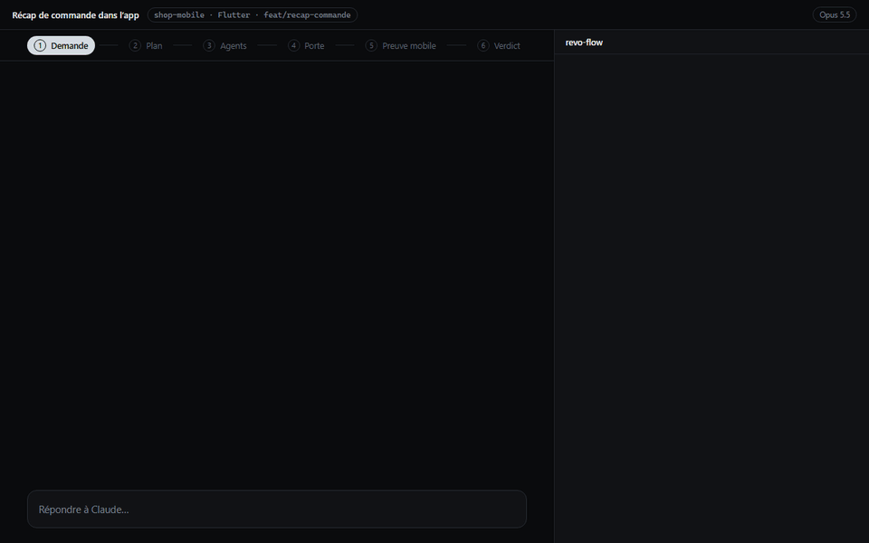

# revo-flow

A Claude Code mod that turns one request into a plan, splits it between sub-agents, shows each agent's progress, and checks the result itself before calling it done.



*A full v3.1 flow with mobile proof on a demo app, replayed with the panel's own drawings: plan, agents, gate, the verifier running the app on a phone, reading the total, tapping "Validate", verdict. The web proof in Chrome: [docs/demo-preuve-web.gif](docs/demo-preuve-web.gif).*

Full documentation is in French: [README.fr.md](README.fr.md).

## Installation

Nothing to download: Claude Code fetches the repository from GitHub. Two ways, pick one.

**From a Claude Code session in a terminal:**

```
/plugin install revo-flow --marketplace LilianMLG/revo-flow
```

Answer `y` to add the marketplace, then Enter for the **user** scope. The mod is active right away.

**From any terminal, without opening Claude:**

```
claude plugin marketplace add LilianMLG/revo-flow
claude plugin install revo-flow@revo-flow
```

The mod then loads in every new session, in the terminal and in the desktop app.

**Auto-update (recommended):** in Claude Code, `/plugin` > **Marketplaces** > **revo-flow** > **Enable auto-update**. Claude Code then fetches the latest published version at the start of each session. Third-party marketplaces have auto-update off by default, so this is a one-time setting. A new version is only detected when `version` changes in `.claude-plugin/plugin.json`.

**Manual update:**

```
claude plugin marketplace update revo-flow
claude plugin update revo-flow@revo-flow
```

## Your first flow

```
/revo-flow <your request>
```

1. **Analysis.** The orchestrator reads your request and the project specs. The panel shows "waiting for the execution plan".
2. **Plan.** It decides how many sub-agents are needed (1 to 6), which model (Haiku, Sonnet, Opus) and effort each one gets, and each agent's task list.
3. **Validation.** The plan is shown in full (agents, roles, why each model, numbered tasks) and waits for **Launch** or **Cancel**, in the dialog or with the panel buttons. The same plan is written to `~/.claude/revo-flow/plans/<title>.md`. No agent starts before you accept.
4. **Execution.** Each agent gets its own progress bar with "n/total" and its current task. The plan can order agents (`apres`: agents to wait for, the verifier last) and declare the files each one will change; a change outside that scope raises a toast and a "Périmètre" section in the report. An agent that depends on another one's work waits, and is resumed when that one finishes.
5. **Verification gate.** When all agents are done, revo-flow runs the project's own lint, type check and related tests itself, with commands rather than a model. It compares against a baseline taken during planning, so only **new** errors count. If the gate is green, the flow ends "verified". If it is red, the orchestrator receives the new errors and must fix them: up to 3 attempts, then you decide (finish unverified, one more attempt, or see the detail). A gate that breaks (a command timing out) no longer ends silently: it asks you to rerun it (twice at most), finish unverified or see the detail. A criterion judged `ko` by the verifier also refuses the conclusion and goes back to the orchestrator (same 3 attempts, then "Finish anyway" or "One more attempt").
6. **End.** A notification gives duration, cost and number of files, and the flow is added to the history (`/revo-flow historique`). A markdown report is written to `~/.claude/revo-flow/rapports/<title>.md`, opening with a plain-language summary (changed, verified, not verified); it links the web or mobile proof screenshots when there are any.

**Budget (v3.6).** At plan validation revo-flow estimates the flow's cost from your history (or defaults) and sets a ceiling, by default twice the estimate with a 2 € floor. A toast at 80 %, then a question at 100 %: Stop, +50 %, or Let it finish. The cost is a client-side estimate, not the bill. See the `budget` option.

**Runtime proof, chosen per project.** For a flow with acceptance criteria, the verifier can ask to see the app running. revo-flow picks the proof that fits the project: a Flutter, Expo or React Native app gets the mobile proof (waiting up to 15 min for the first build); a project with a dev server gets the web proof.

**Web proof (optional, v3.0).** For a flow with acceptance criteria, the verifier can ask to see the app running. After you confirm ("Start `npm run dev` for <project> (port 3000)?"; if the port is already taken, it offers the running server and kills nothing), it browses that one origin with the Claude in Chrome extension and reports the URL visited, what it saw, console errors, 4xx/5xx responses and a screenshot. It catches blank pages, hydration errors and failing API calls that lint, types and unit tests never see. Servers started by revo-flow are always stopped at the end. No test account is ever stored: set `REVO_WEB_LOGIN` for your dev server if the app needs a login. Nuxt, Next, Vite, Astro and Angular are recognized.

**Mobile proof (optional, v3.1).** On a Flutter, Expo or React Native project, the verifier asks for the app on a device. revo-flow picks the device (a plugged-in phone over adb or Xcode first, then a running Android emulator or iOS simulator, then one to start, with its window open so you can watch), asks you ("Launch the Flutter app of <project> on SM A515F (plugged-in phone)?"), launches the app (`flutter run -d`, `expo run:android --device`, `react-native run-android --deviceId`) and tells the verifier when it is on screen. The verifier then observes it live with the `mobile` tool: screenshot (written as `capture-n.png`, read back with Read), view tree with the center of each element (Android), app log (Flutter exceptions, render overflows, logcat errors), tap, swipe, type, back key. Every action shows in the panel while it happens, even when the verifier runs in the background. The app, and the emulator if revo-flow started it, are stopped at the end; a phone or an already running emulator is never touched. On iOS only screenshots (simulator) and the log are available.

**Architecture review (mandatory, v3.2).** Every verified flow ends with an architecture review: the verifier also judges an `ARCHI` step, even when the plan has no criteria. It compares the whole branch (or PR) with the point where it leaves the default branch, and checks that each new or changed file sits where the project keeps its peers, follows the project's naming and layering, and redefines nothing that already exists (types, functions, components). revo-flow gives it the project's architecture documents and computed hints (a file placed away from its peers, a file name already taken, a definition that already exists elsewhere). Once the gate is green, the flow cannot conclude without an `ARCHI` verdict; a `ko` must be fixed and reviewed again (3 attempts, then you decide). Turn it off with the `architecture` option.

A red flow means the gate still finds new lint, type or test errors, or a function changed by the flow with a CRAP score above 30. It never means the agents' own claims were doubted: "I ran the tests and they pass" does not count, only what revo-flow ran. Errors that were already there before the flow are shown separately and do not block.

Without `/revo-flow`, the mod does nothing, except the merge guard.

**Papercuts and stuck agents (v3.7).** Idea from Uber Engineering's 24 November 2026 article on evaluating agent skills. A sub-agent hit by a broken command, script or doc reports it with the `mcp__revo-flow__papercut` tool instead of retrying; reports are stored per project (merged when repeated, 50 at most) and the most seen ones are recalled, with their workaround, to later flows. After 3 failed tool calls in a row an agent is flagged as stuck (toast, panel, hint in the tool result). Sub-agents' final answers are capped at 15 lines. `/revo-flow papercuts` lists them, `/revo-flow papercuts clear` erases them.

**Code Mode (v3.6.1).** revo-flow runs under Claude Code's experimental Code Mode (`CLAUDE_CODE_EXPERIMENTAL_CODE_MODE=1`), where the model's only tool is `REPL`. Tried on Claude Code 2.1.332: the merge guard refuses a push to `main` and `gh pr merge` made from a script, a tool removed from an agent does not exist in its script, and a full flow runs. Not tried: a flow with the gate, frozen tests and the verifier. `/revo-flow doctor` shows whether Code Mode is on.

**Delivery (v3.4 GitHub, v3.5 GitLab).** At the end of a verified flow, on a GitHub repository with `gh` logged in or a GitLab one with `glab` logged in (self-hosted included), revo-flow offers to open the PR (the MR on GitLab) (Draft, Ready for review, or Not now; on a branch that already has an open PR, Push to the PR). With your consent it runs the commands itself: a `revo/<title>` branch when you are on the default branch, a commit of the flow's files only, in the style of your recent commits, a named push, and `gh pr create` or `glab mr create` with the flow report as the description. A self-hosted GitLab is recognized once `glab auth login --hostname <host>` is done, or from a `.gitlab-ci.yml`. It never merges: type `/ship` for the review and the watch, merging stays with you.

**Merge guard (v3.3).** In every session, in a flow or not, revo-flow refuses any Claude command that would merge a PR or MR (`gh pr merge`, `glab mr merge`, the GitHub and GitLab merge APIs), arm auto-merge (`--auto`, `merge_when_pipeline_succeeds`, GitLab push options), or push to the default branch (`main`, `master`, `origin/HEAD`, `--all`, `--branches`, `--mirror`, direct writes through the API). A push must name its branch: `git push` or `git push origin HEAD` is refused, `git push -u origin <branch>` passes. Fixing, pushing a work branch, opening or updating a PR or MR still pass; merging stays with you. It also covers the commands Claude types while `/ship` or `/steward` watches a PR. It is a second barrier, not the guarantee: protect the branch on the server (approval required, merge restricted to maintainers).

## `/revo-flow doctor`

Run it first on a new project. It is read-only: it shows what revo-flow detected and what it will do there, without running or changing anything.

- the stack it recognized;
- the verification commands it would use (lint, type check, related tests), and where each comes from;
- the baseline of existing errors;
- the project cache (file graph, feature sheets);
- the installed agents it can offer to the orchestrator;
- the `Web` line: dev server command and port for the web proof, where they come from, which browser tools are available, and whether `REVO_WEB_LOGIN` is set; on a mobile app, a `Mobile` line instead: framework, platforms and the devices seen (plugged-in phone, emulator, simulator);
- known pitfalls for this project.

## Commands

| Command | Effect |
| --- | --- |
| `/revo-flow <request>` | start a flow |
| `/revo-flow statut` | where each agent stands |
| `/revo-flow panneau` | show or hide the side panel |
| `/revo-flow historique [n]` | the last n flows: date, duration, cost, agents, failures |
| `/revo-flow stop` | stop the running agents and the orchestrator's turn, after confirmation |
| `/revo-flow doctor` | what revo-flow found on the project (read-only) |
| `/revo-flow papercuts [clear]` | friction reports filed by agents on this project (v3.7) |
| `/revo-flow version` | the mod version |
| `/revo-flow cache` | the project's file graph and feature sheets |
| `/revo-flow cache build` / `clear` / `<keyword>` | rebuild, delete, or search the cache |

An interrupted flow (Claude Code restarted) can be resumed or abandoned at the next start.

## Options

Set in `/config`.

| Option | Default | Effect |
| --- | --- | --- |
| `validerPlan` | yes | ask for Launch or Cancel before agents start |
| `conflits` | `avertir` | file already changed by another running agent: `avertir` shows a toast, `refuser` blocks the edit |
| `notifier` | yes | system notification when a flow ends or an agent fails |
| `verif` | `bloquer` | `bloquer` refuses the end of a flow while new errors remain, `observer` checks and shows without blocking, `off` does not check |
| `budget` | `auto` | cost ceiling per flow (v3.6): `auto` is 2 × the plan's estimate (2 € at least), a number is a ceiling in euros, `off` or `0` disables it; alert at 80 %, question at 100 % (Stop, +50 %, Let it finish) |
| `papercuts` | yes | `papercut` tool for sub-agents, known papercuts recalled to later flows, stuck-agent alert after 3 failed tool calls in a row; `non` turns it off (the 15-line final answer cap stays) |
| `crap` | yes | CRAP score in the gate: a function changed by the flow above 30 is a new error |
| `cache` | yes | inject the project cache brief and feature excerpts, and offer the `cache` tool |
| `web` | `extension` | web proof by the verifier: `extension` starts the dev server (after confirmation) and browses with Claude in Chrome, `devtools` also declares the Chrome DevTools MCP as a fallback, `off` disables it |
| `mobile` | `appareil` | mobile proof by the verifier (v3.1): `appareil` picks the device (plugged-in phone, else an emulator or simulator started with its window), launches the app after confirmation and observes it live with the `mobile` tool, `mcp` also declares the mobile-mcp server, `off` disables it |
| `livraison` | yes | delivery (v3.4 GitHub, v3.5 GitLab): at the end of a verified flow, offer to open the PR or MR (draft or ready); revo-flow branches, commits the flow's files, pushes the named branch and runs `gh pr create` or `glab mr create` with the report; never merges; `no` offers nothing |
| `gardeMerge` | yes | merge guard (v3.3): refuse any Claude command that merges a PR or MR, arms auto-merge or pushes to the default branch, in a flow or not; `no` turns it off |
| `architecture` | on | mandatory architecture review by the verifier at the end of each verified flow (v3.2): files in the right place, project conventions, nothing redefined; the gate waits for its verdict; off makes the verifier optional again |
| `agents` | yes | offer your installed agents (project, personal, enabled plugins) to the orchestrator |

## More

- [README.fr.md](README.fr.md): complete documentation (in French).
- [docs/](docs/): design notes and R&D for the cache, the verified flow and v3.

## License

[MIT](LICENSE)
