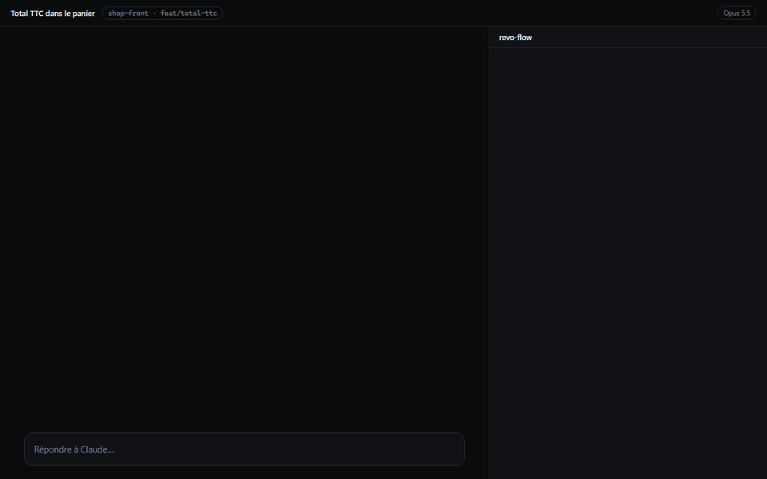

# revo-flow

A Claude Code mod that turns one request into a plan, splits it between sub-agents, shows each agent's progress, and checks the result itself before calling it done.



*A full flow with the v3 web proof, replayed with the panel's own drawings: plan, agents, gate, the verifier opening the app on localhost, verdict.*

Full documentation is in French: [README.fr.md](README.fr.md).

## Installation

Nothing to download: Claude Code fetches the repository from GitHub. Two ways, pick one.

**From a Claude Code session in a terminal:**

```
/plugin install revo-flow --marketplace LilianMLG/revo-flow
```

Answer `y` to add the marketplace, then Enter for the **user** scope. The mod is active right away.

**From any terminal, without opening Claude:**

```
claude plugin marketplace add LilianMLG/revo-flow
claude plugin install revo-flow@revo-flow
```

The mod then loads in every new session, in the terminal and in the desktop app.

**Auto-update (recommended):** in Claude Code, `/plugin` > **Marketplaces** > **revo-flow** > **Enable auto-update**. Claude Code then fetches the latest published version at the start of each session. Third-party marketplaces have auto-update off by default, so this is a one-time setting. A new version is only detected when `version` changes in `.claude-plugin/plugin.json`.

**Manual update:**

```
claude plugin marketplace update revo-flow
claude plugin update revo-flow@revo-flow
```

## Your first flow

```
/revo-flow <your request>
```

1. **Analysis.** The orchestrator reads your request and the project specs. The panel shows "waiting for the execution plan".
2. **Plan.** It decides how many sub-agents are needed (1 to 6), which model (Haiku, Sonnet, Opus) and effort each one gets, and each agent's task list.
3. **Validation.** The plan is shown in full (agents, roles, why each model, numbered tasks) and waits for **Launch** or **Cancel**, in the dialog or with the panel buttons. The same plan is written to `~/.claude/revo-flow/plans/<title>.md`. No agent starts before you accept.
4. **Execution.** Each agent gets its own progress bar with "n/total" and its current task. An agent that depends on another one's work waits, and is resumed when that one finishes.
5. **Verification gate.** When all agents are done, revo-flow runs the project's own lint, type check and related tests itself, with commands rather than a model. It compares against a baseline taken during planning, so only **new** errors count. If the gate is green, the flow ends "verified". If it is red, the orchestrator receives the new errors and must fix them: up to 3 attempts, then you decide (finish unverified, one more attempt, or see the detail).
6. **End.** A notification gives duration, cost and number of files, and the flow is added to the history (`/revo-flow historique`). A markdown report is written to `~/.claude/revo-flow/rapports/<title>.md`; it links the web proof screenshots when there are any.

**Web proof (optional, v3.0).** For a flow with acceptance criteria, the verifier can ask to see the app running. After you confirm ("Start `npm run dev` for <project> (port 3000)?"; if the port is already taken, it offers the running server and kills nothing), it browses that one origin with the Claude in Chrome extension and reports the URL visited, what it saw, console errors, 4xx/5xx responses and a screenshot. It catches blank pages, hydration errors and failing API calls that lint, types and unit tests never see. Servers started by revo-flow are always stopped at the end. No test account is ever stored: set `REVO_WEB_LOGIN` for your dev server if the app needs a login. Nuxt, Next, Vite, Astro and Angular are recognized; no mobile.

A red flow means the gate still finds new lint, type or test errors, or a function changed by the flow with a CRAP score above 30. It never means the agents' own claims were doubted: "I ran the tests and they pass" does not count, only what revo-flow ran. Errors that were already there before the flow are shown separately and do not block.

Without `/revo-flow`, the mod does nothing.

## `/revo-flow doctor`

Run it first on a new project. It is read-only: it shows what revo-flow detected and what it will do there, without running or changing anything.

- the stack it recognized;
- the verification commands it would use (lint, type check, related tests), and where each comes from;
- the baseline of existing errors;
- the project cache (file graph, feature sheets);
- the installed agents it can offer to the orchestrator;
- the `Web` line: dev server command and port for the web proof, where they come from, which browser tools are available, and whether `REVO_WEB_LOGIN` is set;
- known pitfalls for this project.

## Commands

| Command | Effect |
| --- | --- |
| `/revo-flow <request>` | start a flow |
| `/revo-flow statut` | where each agent stands |
| `/revo-flow panneau` | show or hide the side panel |
| `/revo-flow historique [n]` | the last n flows: date, duration, cost, agents, failures |
| `/revo-flow stop` | stop the running agents and the orchestrator's turn, after confirmation |
| `/revo-flow doctor` | what revo-flow found on the project (read-only) |
| `/revo-flow version` | the mod version |
| `/revo-flow cache` | the project's file graph and feature sheets |
| `/revo-flow cache build` / `clear` / `<keyword>` | rebuild, delete, or search the cache |

An interrupted flow (Claude Code restarted) can be resumed or abandoned at the next start.

## Options

Set in `/config`.

| Option | Default | Effect |
| --- | --- | --- |
| `validerPlan` | yes | ask for Launch or Cancel before agents start |
| `conflits` | `avertir` | file already changed by another running agent: `avertir` shows a toast, `refuser` blocks the edit |
| `notifier` | yes | system notification when a flow ends or an agent fails |
| `verif` | `bloquer` | `bloquer` refuses the end of a flow while new errors remain, `observer` checks and shows without blocking, `off` does not check |
| `crap` | yes | CRAP score in the gate: a function changed by the flow above 30 is a new error |
| `cache` | yes | inject the project cache brief and feature excerpts, and offer the `cache` tool |
| `web` | `extension` | web proof by the verifier: `extension` starts the dev server (after confirmation) and browses with Claude in Chrome, `devtools` also declares the Chrome DevTools MCP as a fallback, `off` disables it |
| `agents` | yes | offer your installed agents (project, personal, enabled plugins) to the orchestrator |

## More

- [README.fr.md](README.fr.md): complete documentation (in French).
- [docs/](docs/): design notes and R&D for the cache, the verified flow and v3.

## License

[MIT](LICENSE)
